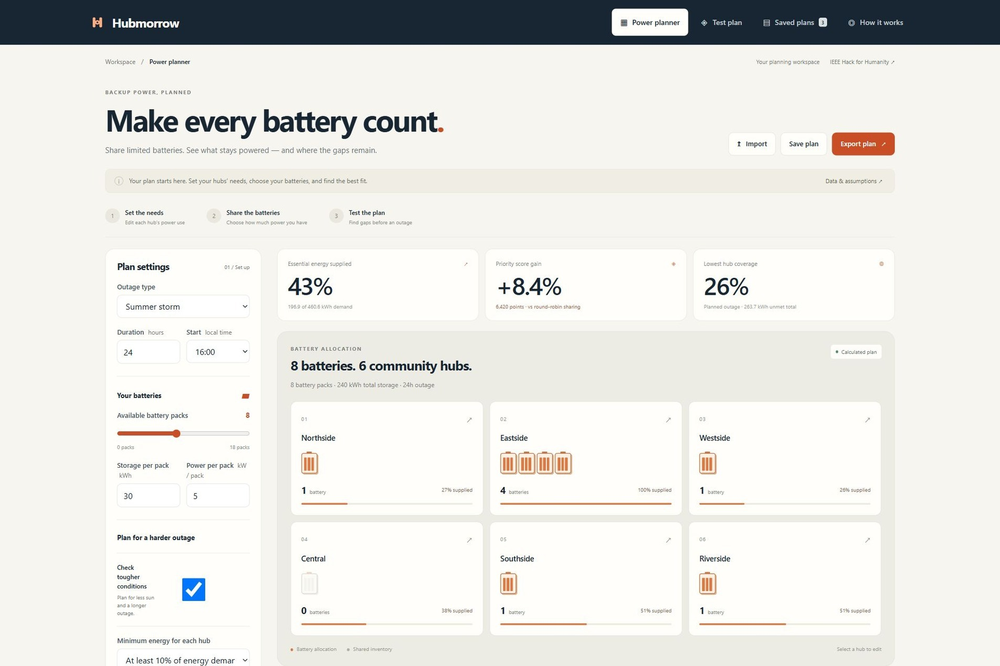
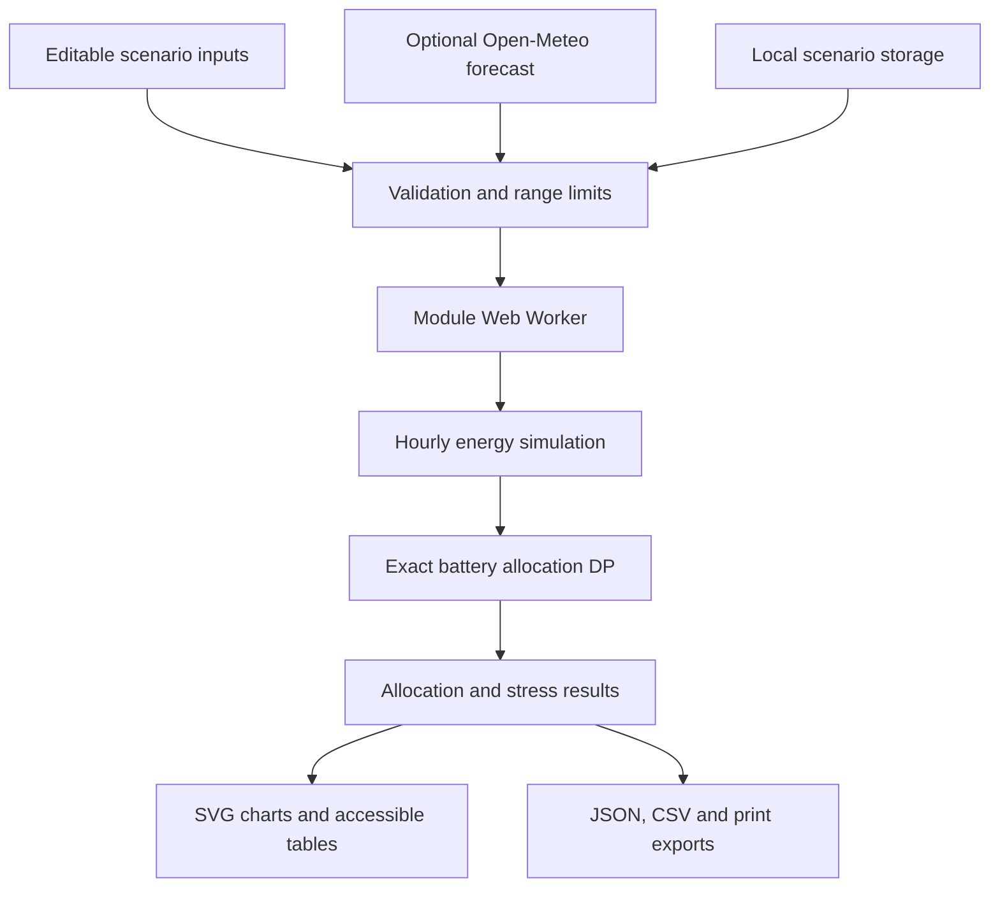

<p align="center"></p>
<h1 align="center">Hubmorrow</h1>
<p align="center"><strong>Backup power, planned.</strong></p>
<p align="center">Share limited batteries across community hubs.<br>See what stays powered — and where the gaps remain.</p>
<p align="center">


</p>
<p align="center"><a href="https://hubmorrow.sturdynova2049.chatgpt.site"><strong>Open the app ↗</strong></a> · <a href="docs/ARCHITECTURE.md">Architecture</a> · <a href="docs/QA.md">Test record</a> · <a href="docs/RESEARCH.md">Research</a></p>



**For community coordinators preparing for an outage.** Enter each hub’s power needs, choose your batteries, and calculate how to share them. Test the plan with less sun or a longer outage before you commit.

Built for **IEEE Hack for Humanity · Power & Energy**. The core journey works in the browser with **no account, API key, application server, or third-party runtime packages**. Starting hub values are sample data; optional Charlotte weather comes from Open-Meteo.

## The problem

A community coordinator has several places that could support residents during an outage and a limited inventory of portable batteries. Equal battery counts do not imply equal service: each hub has different loads, solar availability, occupancy assumptions, and community priorities.

Hubmorrow answers a bounded question: **given these inputs, how should whole battery packs be allocated, and where does that plan still leave service gaps?** Every calculated plan shows its assumptions and unmet power needs.

[View 15 application screenshots with captions](docs/GALLERY.md).

## What you can do

- Six editable illustrative hubs, each with communications, refrigeration, cooling, lighting, solar, occupancy, and priority inputs.
- Battery count, kWh capacity, inverter kW, initial charge, reserve, and efficiency controls.
- Nominal or conservative stress-aware exact integer optimization.
- An optional minimum service floor at every hub, with explicit infeasibility feedback.
- Hourly solar/storage/load balance, service coverage, unmet kWh, and a priority-weighted score.
- A fixed-allocation stress lab: planned outage, 40% solar reduction, and a 12-hour longer outage with 15% higher demand (60-hour cap).
- A round-robin comparison that obeys the same selected floor.
- Optional Open-Meteo hourly forecast for fixed Charlotte coordinates, with timeout, response validation, explicit provenance, and a synthetic-weather reset.
- Local scenario saving, restore/removal, file or pasted JSON import, JSON/clipboard export, formula-safe CSV export, and print report.
- Per-hub allocation explanations tied to actual minimum packs and one-pack counterfactual score losses.
- Responsive layouts, keyboard-operable forms and dialogs, accessible hourly data tables, and reduced-motion support.

## Quick start

Requirements: Python 3 for a simple static server; Node.js 22+ to run the tests. No package installation is required.

```bash
python3 -m http.server 8000 --directory dist
```

Open http://localhost:8000. Serve over HTTP rather than opening `index.html` as a file so browser modules and the worker load correctly.

```bash
npm run check
npm test
```

The tests cover hand-calculated discharge, inverter and reserve limits, loss accounting, energy conservation, zero batteries, infeasible floors, exhaustive-search agreement, floor enforcement, input validation, weather units and horizon, formula injection protection, and monotonic optimal scores.

## Architecture and data flow



`dist/engine.js` is the pure model, validator, optimizer, and CSV serializer. `dist/worker.js` runs the optimizer off the UI thread. `dist/app.js` owns interface state, chart rendering, scenario storage, and the optional forecast call. If module workers are unavailable, the same deterministic model runs on the main thread.

There is no central database, authentication, multi-user synchronization, analytics, or server-side personal data storage. Those are not needed for this single-user planning journey. Local storage holds a maximum of 30 scenarios; imported JSON is limited to 1 MB, 8 hubs, 18 packs, and bounded numerical inputs.

## How the calculations work

Each time step is one hour. Solar serves loads first. Surplus can charge batteries; deficits can discharge them subject to power, state-of-charge, reserve, and efficiency limits. Unmet load is recorded. Energy conservation is tested:

`initial storage + solar = supplied loads + spilled solar + losses + ending storage`

- Approximate PV output: `array kWp × horizontal irradiance / 1000 × 0.80`.
- Charge/discharge efficiency each equals the square root of the configured round-trip efficiency.
- Cooling factor: `clamp(0.75 + max(0, temperature − 24) × 0.075, 0.5, 2.5)`.
- Lighting factor: 1 between 18:00 and 07:00; otherwise 0.35.
- Loads at a hub are served proportionally as an essential bundle.
- Equivalent service-hours: sum of each hour's supplied/demand fraction.
- Nominal score: service-hours × assumed occupancy × user-set priority, summed across hubs.
- Stress-aware score: each hub's lowest service-hours/duration ratio across the three stress cases × planned duration × occupancy × priority, summed across hubs.

Stress-aware optimization uses **the sum of each hub's worst-case score**, not the worst system-wide score across scenarios. Dynamic programming is exact for this separable discrete model. The state is `(hubs processed, packs used)`; transition complexity is O(hubs × packs²), after precomputing simulations. All available packs are allocated; zero marginal-value packs may still be assigned deterministically.

The service floor is an energy coverage constraint. With stress-aware planning enabled, it must hold at each hub across all three cases; in nominal mode it applies only to the planned outage. The baseline first assigns the minimum feasible packs per hub, then distributes remaining packs in listed round-robin order.

## Check the sample result

The default training case uses eight 30 kWh packs, a 24-hour outage from 16:00, 90% initial charge, 10% reserve, 94% round-trip efficiency, 55% solar availability, and a 10% per-hub floor. Results can be reproduced with:

```bash
node --input-type=module -e "import {defaults,plan} from './dist/engine.js'; const p=plan(defaults()); console.log(p.optimal.allocation,p.optimal.totals,p.score,p.baselineScore)"
```

The default allocation is `[1, 4, 1, 0, 1, 1]` in hub table order. The central hub receives no pack because its modeled solar output already meets the chosen minimum. The optimized priority score is about 8.37% higher than the floor-compliant round-robin baseline **in this synthetic exercise**. That is not a measured improvement for a real community. Changes to assumptions can change the allocation and the result. The score weights service continuity by occupancy and priority; its optimum can have lower aggregate kWh coverage than round-robin. Both measures are shown in the stress lab.

## Data provenance and attribution

All hub names, capacity assumptions, loads, solar installations, and priority weights are original illustrative fixtures. There is no live facility or outage dataset and no private household or medical information.

Default weather is a deterministic synthetic daylight/temperature curve. The optional forecast requests four days of hourly temperature and shortwave radiation from Open-Meteo, starting at midnight on forecast day one in `America/New_York`. The start-hour setting is relative to that first date. Forecast snapshots retain their original retrieval time; they can be exported and replayed. Solar and stress multipliers remain in effect even when a forecast is loaded.

- Belding and Beshilas, **Ensuring Resilient Operations of Solar-Plus-Storage Community Resilience Hubs**, NREL/DOE, 2024: https://www.nlr.gov/docs/fy24osti/89601.pdf
- **REopt Web Tool User Manual**, an established energy/resilience optimization reference: https://reopt.nlr.gov/tool/reopt-user-manual.pdf
- **Open-Meteo Forecast API**, weather model outputs, CC BY 4.0 data attribution; [CC BY 4.0 license](https://creativecommons.org/licenses/by/4.0/); raw snapshots are retained and derived model outputs apply configured scaling. The free endpoint is for noncommercial use: https://open-meteo.com/en/docs and https://open-meteo.com/en/terms
- **Apple Human Interface Guidelines**, accessibility, layout, and charts informed design principles; no Apple assets or interface were copied: https://developer.apple.com/design/human-interface-guidelines

REopt is a research reference, not a dependency or integrated service. No code was copied from competing projects. See [research and compliance](docs/RESEARCH.md) for the idea comparison and [architecture](docs/ARCHITECTURE.md) for the schema and contracts.

For observed browser results and remaining verification limits, see [QA record](docs/QA.md).

## Deployment

Deploy the contents of `dist/` to a static host using HTTPS. No build transform or environment variables are required. Vercel or Netlify can use `dist` as the output directory and an empty build command. The live review build is hosted with ChatGPT Sites. The public source can also be served on any static host.

Recommended security headers are supplied in `dist/_headers` for hosts that support that file. Verify the target host actually applies them. The application requires same-origin module scripts/workers and outbound access only to `https://api.open-meteo.com` for its optional forecast. No secret belongs in the browser bundle.

## Privacy, safety, limitations

Scenario inputs remain in the user's browser unless exported. Weather requests include only fixed Charlotte coordinates and normal network metadata. Local storage is not encrypted; avoid entering sensitive names or medical details. Same-device visitors to the same browser profile may access its saved scenarios.

This model omits site surveys, installation/travel time, inverter compatibility, islanding equipment, surge currents, battery aging, detailed PV geometry, thermal comfort, weather probabilities, and electrical-network topology. Assumed occupancy is not a count of unique people helped. Energy availability does not prove food safety, medical suitability, or shelter suitability. Real deployment requires measured loads, community consultation, electrical engineering review, compatible certified equipment, and approved operating procedures.

## Contribution and AI disclosure

Developed for this project with substantial ChatGPT/Codex assistance in research, design, architecture, implementation, testing, and documentation. The runtime uses deterministic calculations and has no language-model dependency. Human team-member responsibilities have not been supplied and are not invented here. Participants must verify and own the claims before final submission.

MIT license for original code. External data, reference documents, and service terms retain their respective licenses. See [LICENSE](LICENSE).

## Submission review

The [Devpost project draft](https://devpost.com/software/gridrelief-community-backup-power-planner) contains the saved story and links and remains incomplete pending media and participant review. See [handoff](docs/HANDOFF.md) and [submission text](docs/DEVPOST_DRAFT.md). The project stays a draft until participant review. Final submission is a separate action.

## Project layout

| Path                                 | Purpose                                                  |
| ------------------------------------ | -------------------------------------------------------- |
| `dist/index.html`, `dist/styles.css` | Accessible responsive interface                          |
| `dist/app.js`                        | Navigation, editing, charts, weather and browser storage |
| `dist/engine.js`                     | Validation, energy simulation and exact allocator        |
| `dist/worker.js`                     | Background calculation                                   |
| `tests/engine.test.mjs`              | Model and security regression tests                      |
| `docs/`                              | Research, architecture, design and QA evidence           |

## Contributing

Create a focused branch and open a pull request. Explain the problem, resulting behavior and relevant test results. Run `npm run build` before review. Keep secrets and personal data out of source and fixtures. Branch protection is pending the owner’s GitHub access verification; it is not claimed as enabled.
