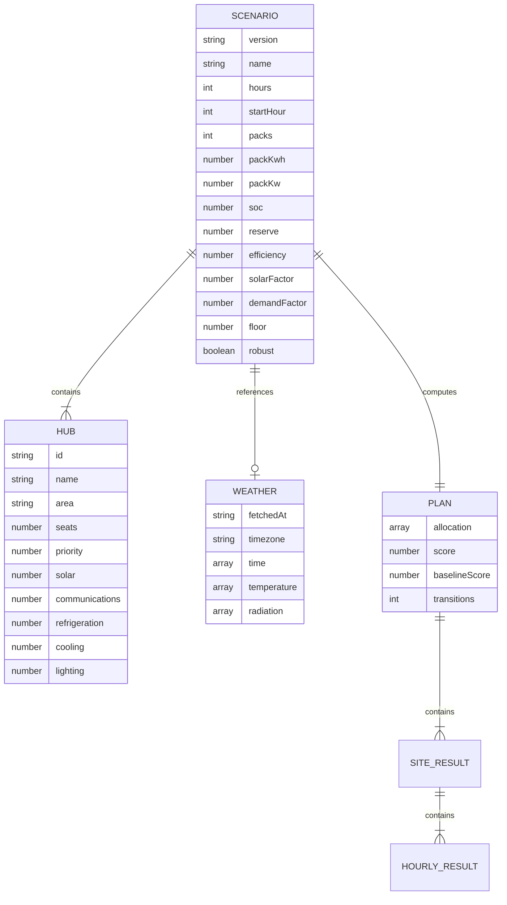

# Architecture and acceptance criteria

## User journey

1. Open a training case with transparent defaults and provenance.
2. Configure outage and available battery inventory; edit individual hubs.
3. Calculate the exact discrete allocation under the selected objective and minimum coverage constraint.
4. Inspect supplied/unmet energy and the round-robin comparison.
5. Reuse the fixed allocation under three stress cases; identify gaps.
6. Save inputs on this device or export a reproducible JSON bundle/CSV/print report.

Acceptance: changing inputs invalidates export until recalculation; infeasible floors produce an explicit error; forecast failure retains the existing weather; imported results are never trusted and are recalculated; saved scenarios restore all validated inputs.

## Data schema

These relationships are in-memory objects, not database tables. Local persistence is a bounded JSON array under `gridrelief.scenarios.v1`. No database permissions or authentication endpoints are necessary for this single-user local workflow.

## Contracts

- `validate(raw) -> Scenario`: rejects incorrect types, nonfinite/range errors, duplicate IDs, malformed weather, and invalid electrical loads; returns a whitelisted object.
- `simulateHub(hub, packCount, scenario, stress?) -> SiteResult`: deterministic, one-hour time steps; records supplied, unmet, solar, spill, charge/discharge, loss, and storage.
- `plan(raw) -> Plan`: validates first; precomputes per-site/count/stress simulations; enforces floors; solves exact integer allocation and same-floor baseline.
- Worker request: `{id, scenario}`; reply: `{id, result}` or `{id, error}`. Request IDs suppress obsolete results.
- Weather: fixed GET endpoint in `engine.js`; accepts only expected Celsius/W/m² arrays and ISO hourly timestamps, with enough records for the longest stress horizon. Credentials and referrer are omitted.
- Import: JSON smaller than 1 MB, either a scenario or an export containing `scenario`; derived results are discarded and recomputed.
- Export: whitelisted scenario plus actual calculated results and a simulation disclaimer; CSV escapes quotes and spreadsheet formula prefixes.

## Constraints and recovery

The maximum is 8 hubs × 18 packs, 48 planned outage hours, 60 stress hours, and 30 saved scenarios. Integer DP has O(hubs × packs²) transitions after O(hubs × packs × cases × hours) simulation preprocessing. The module worker keeps normal computation off the main thread; a deterministic main-thread fallback exists.

Browser storage failures and quota errors are surfaced without claiming a save. Weather failures retain the previous input. An infeasible plan leaves previous results clearly marked as previous and disables export. Native form checks complement, but never replace, model validation.

## Security boundary

No backend credentials, cloud storage, private-data API, privileged authorization, device control, or payment integration exists. Escaped user strings, whitelisted imports, resource bounds, safe CSV output, isolated worker computation, and no HTML from external data limit the attack surface. Custom host security headers are recommendations until verified on the chosen host.

## Deployment

The complete app is served from `dist/`. No transpiler or dependency installation is needed. Tests run in Node and use the same model imported by the UI worker. Hosted source is versioned before publication. Public access is intentional for judge review. The static deployment does not imply emergency certification or operational readiness.
