# Hubmorrow image gallery

15 actual application views. Desktop captures are 1905 × 1270 (3:2). Image 15 arranges unchanged phone and tablet captures on a labeled canvas. No app UI or results were generated or retouched.

## 01. Power planner

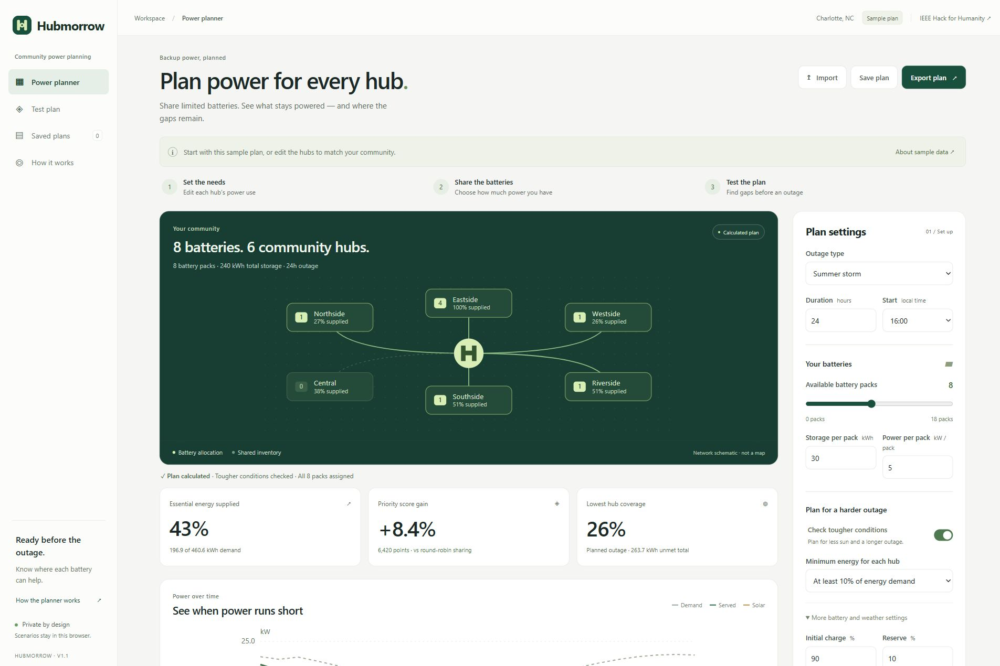

Plan backup power for a community. This sample shares eight batteries across six hubs and shows supplied energy, priority-score gain and remaining gaps.

## 02. Hub power needs

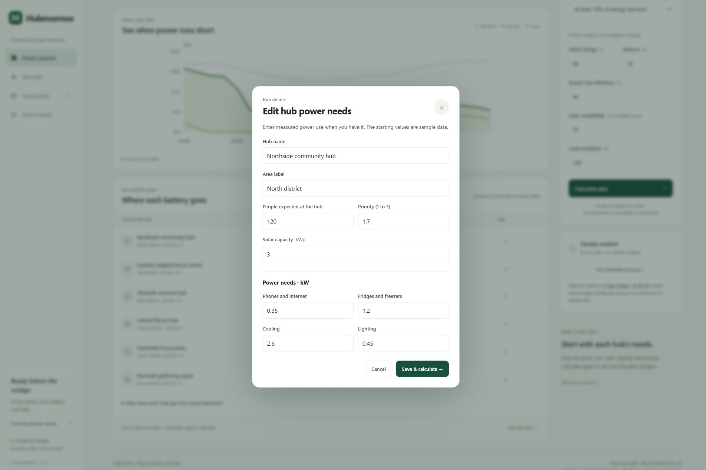

Set each hub's power needs. Edit phones and internet, refrigeration, cooling, lighting, solar capacity, expected occupancy and priority before calculating.

## 03. Battery assumptions

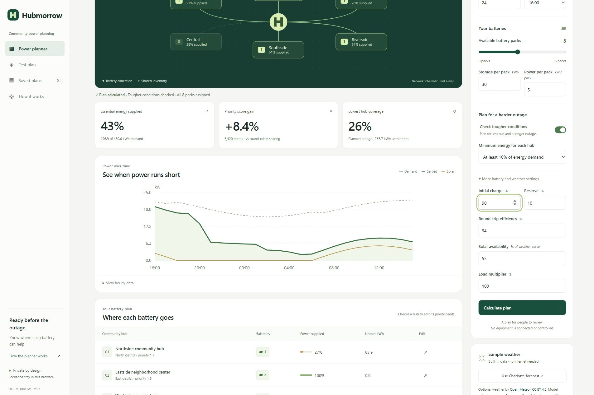

Make the assumptions visible. Adjust initial battery charge, reserve, efficiency, solar availability and load levels before calculating.

## 04. Recalculate an outage

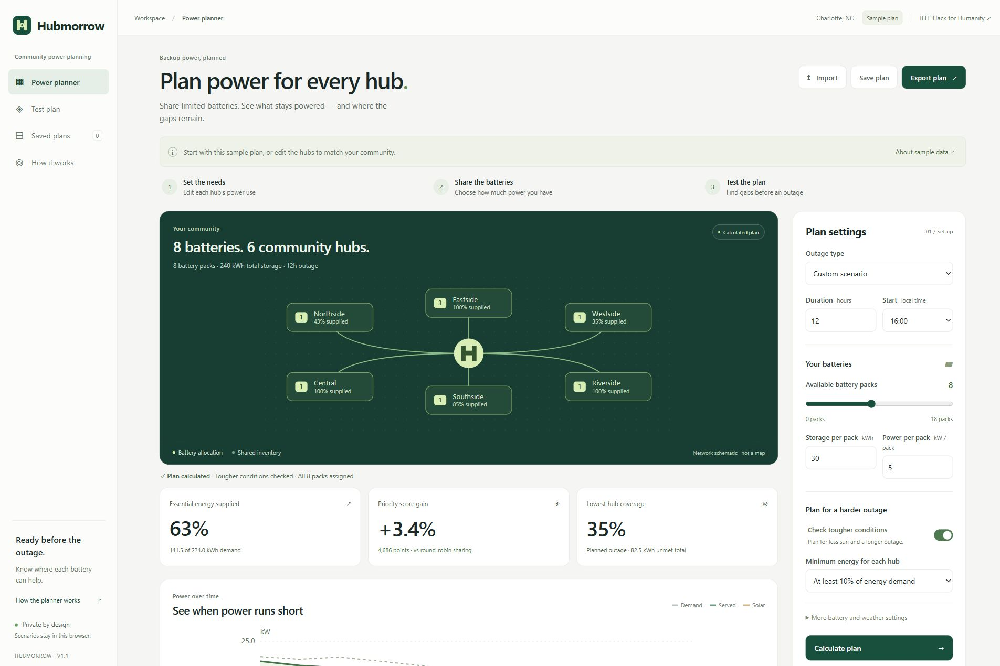

Explore a shorter outage. Changing the duration to 12 hours recalculates battery assignments, energy coverage and the hourly power balance.

## 05. Clear infeasibility

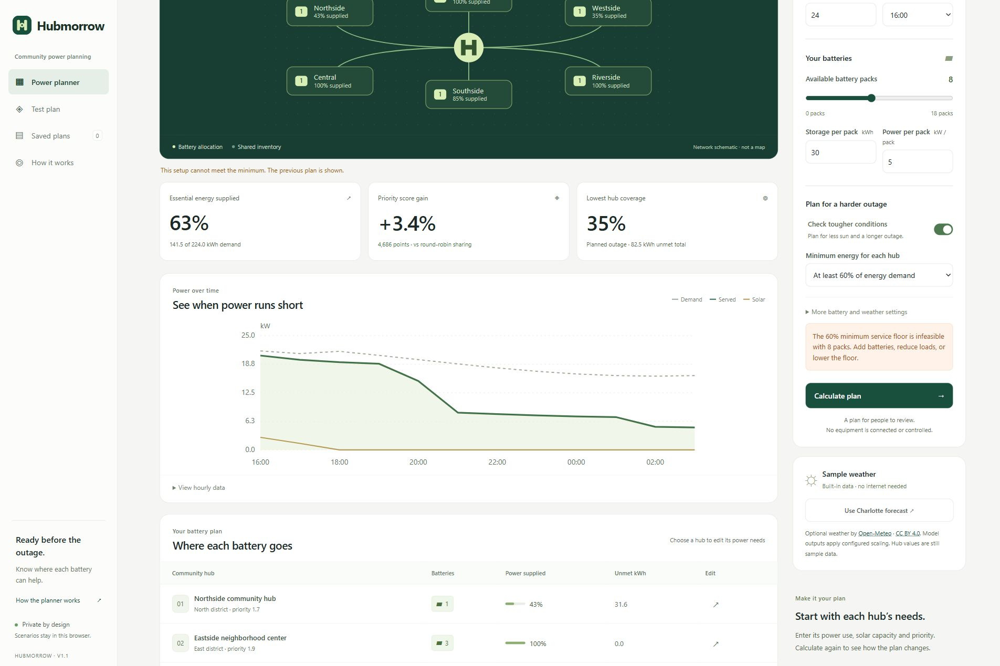

Get a clear answer when a request is impossible. A 60% minimum at every hub cannot be met with eight packs, so the app asks for more batteries, lower loads or a lower minimum.

## 06. Test three conditions

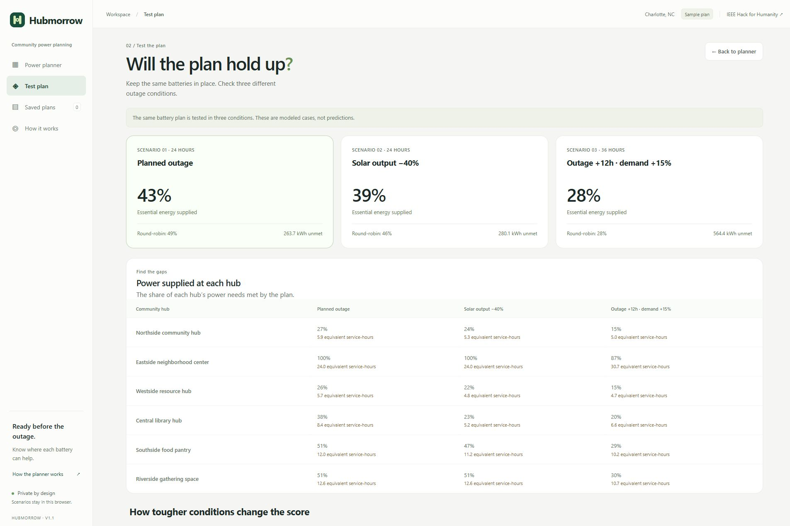

Test the same battery plan in three conditions: the planned outage, 40% less solar, and a 12-hour longer outage with 15% more demand. The round-robin comparison uses the same resources and minimum.

## 07. Allocation reasons

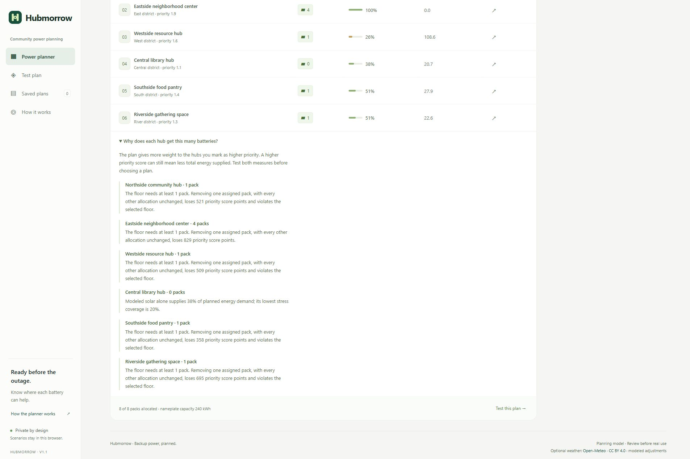

See the reason for each assignment. The explanation shows the minimum packs needed and the priority-score loss from removing one pack, while keeping other assignments fixed.

## 08. Hourly energy table

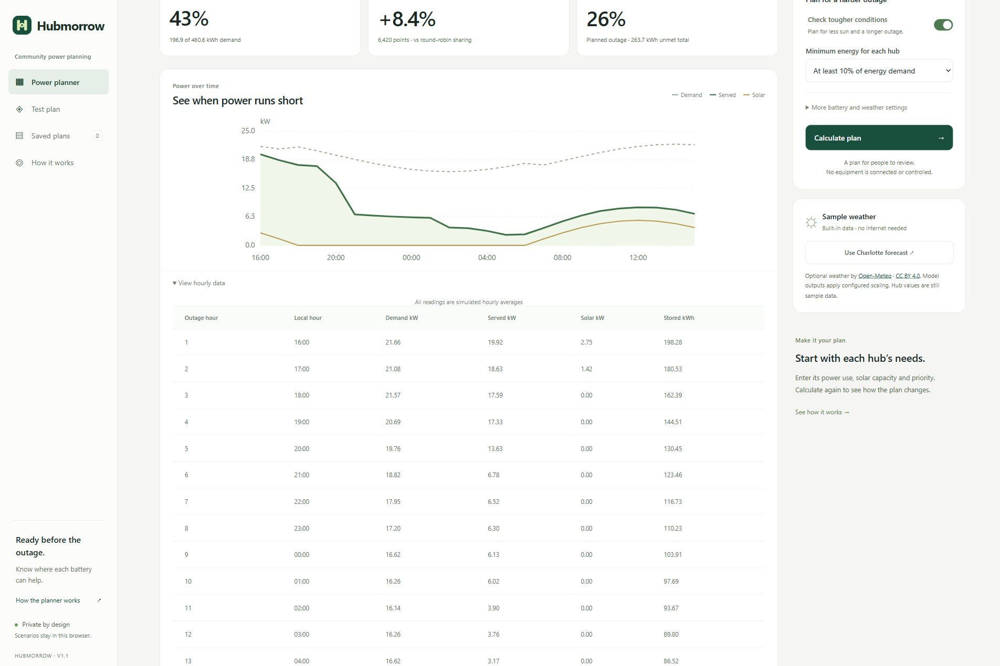

Inspect the hourly values behind the chart. The accessible table reports demand, supplied power, solar output and stored energy for each modeled hour.

## 09. Optional weather

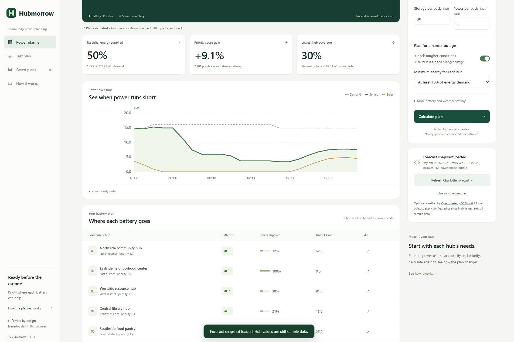

Use an optional Charlotte forecast from Open-Meteo. The app shows the snapshot date and retrieval time, retains attribution and recalculates with the selected weather. Hub values remain sample data.

## 10. Save a plan

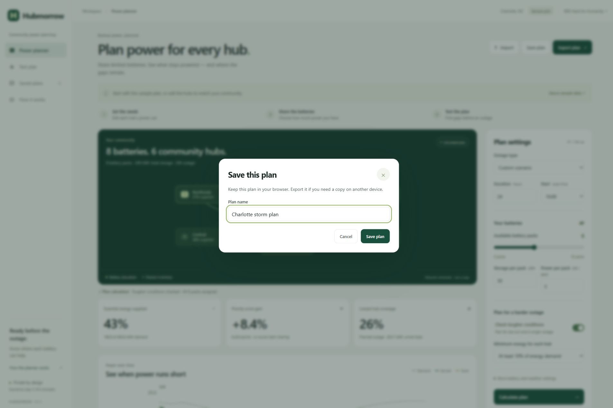

Keep a named plan in this browser. Save its inputs so you can open it later, change the assumptions and calculate again.

## 11. Reopen saved plans

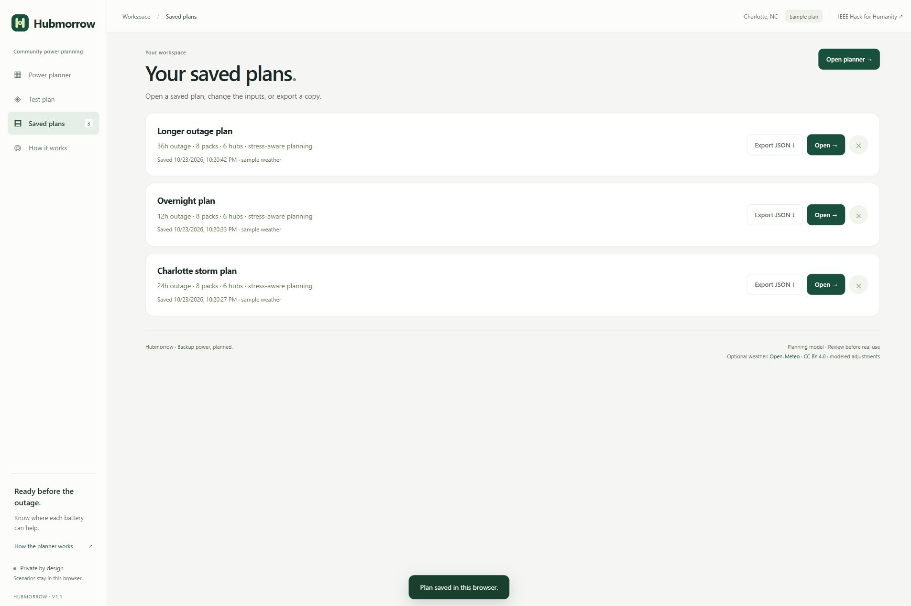

Compare saved planning cases. These three sample plans were created through the app: a 24-hour storm, a 12-hour overnight outage and a 36-hour case without a minimum floor.

## 12. Export and inspect

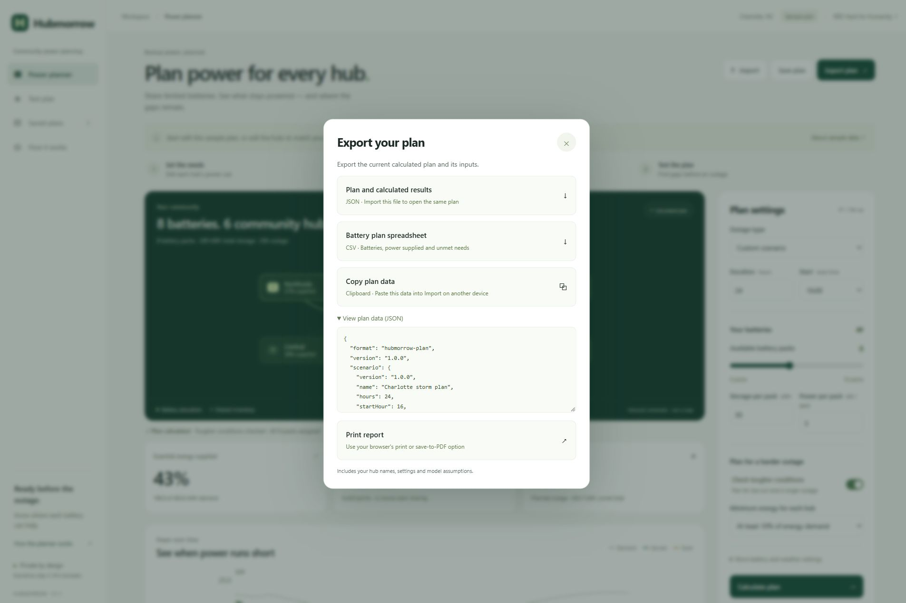

Take the plan with you. Export calculated inputs and results as JSON, create a CSV allocation table, copy plan data or print a report. The JSON preview makes the inputs inspectable.

## 13. Import and recalculate

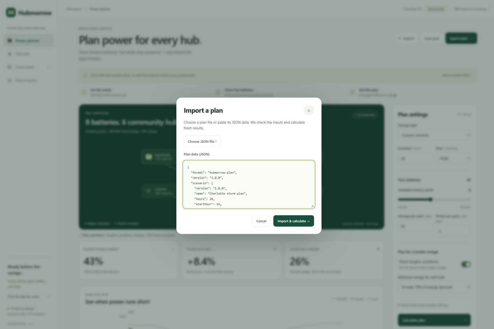

Reopen the same plan from JSON. Inputs are checked, imported results are discarded and the app calculates fresh results. Clipboard export and pasted import were verified end to end.

## 14. Method and data

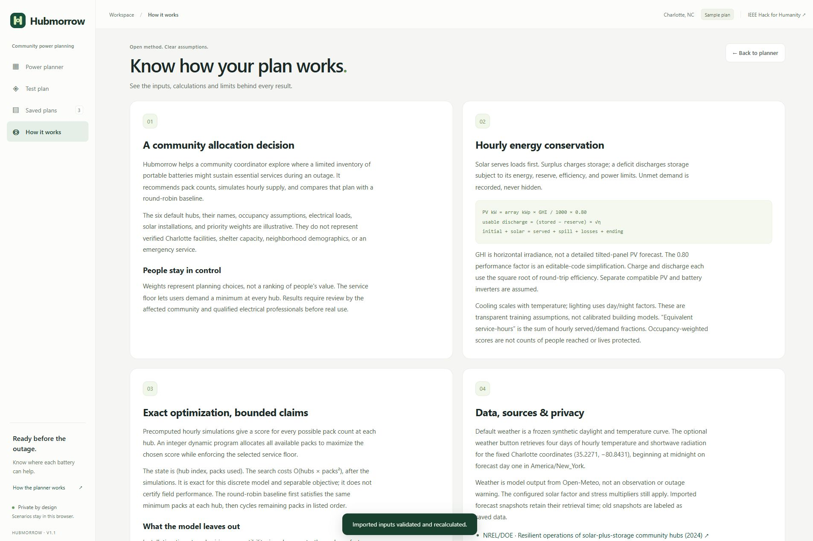

Know how the result works. Read the energy-balance rules, exact allocation method, data sources, privacy choices and practical limits before real use.

## 15. Phone and tablet

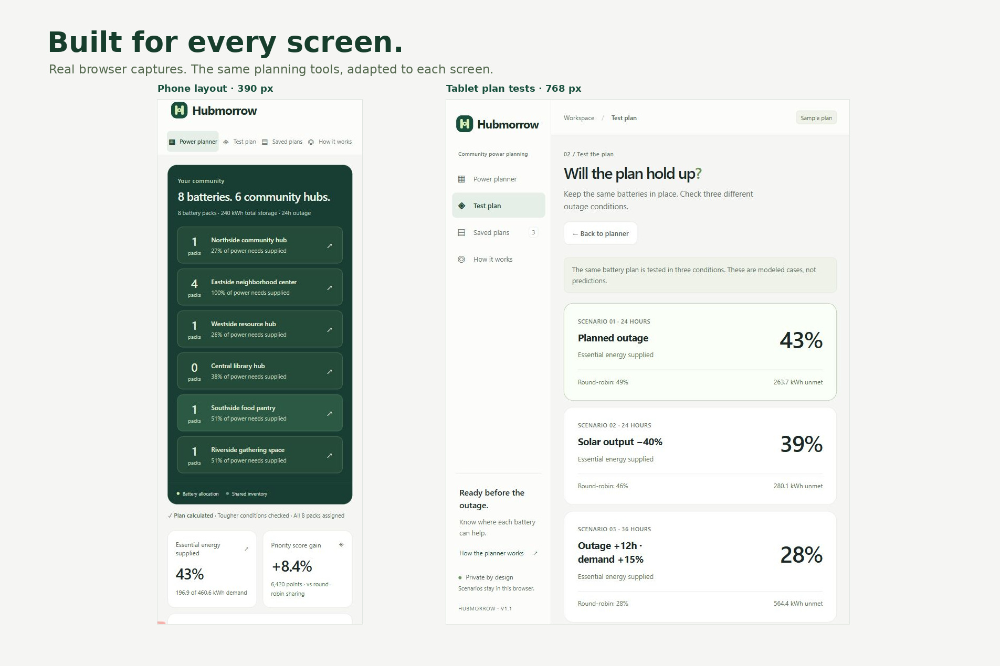

Use the planner on different screens. These unretouched browser captures show editable hub rows at 390 px and the plan tests at 768 px. The layout adapts without hiding the key decisions.

